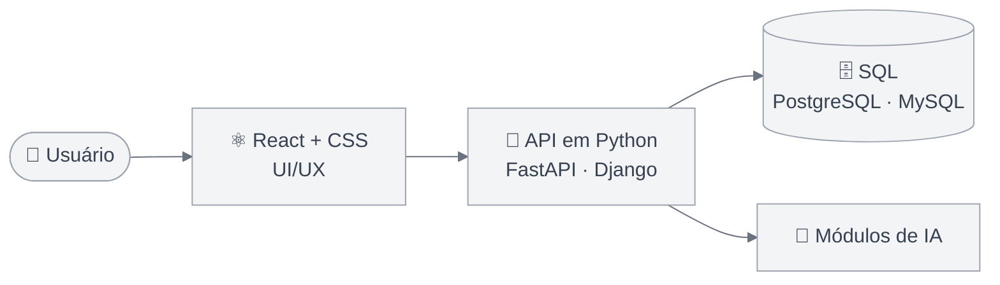

<!-- Paleta (cinza claro, baseada na foto): #F3F4F6 · #E5E7EB · #D1D5DB · #9CA3AF · #6B7280 · #4B5563 · #374151 -->

<div align="center">


<a href="https://github.com/guilhermeasilva84-lgtm">
  
</a>

<br/><br/>


</div>

<br/>

<h2 align="center">👋 Sobre mim</h2>


> 💬 *"Código bom é aquele que outra pessoa consegue ler, manter e evoluir."*

```python
class GuilhermeSilva(Developer):
    """Python Backend Developer com visão fullstack."""

    foco = "Back-end com Python"
    stack = ["Python", "FastAPI", "Django", "SQL", "React", "CSS"]
    ux = "Interfaces limpas, rápidas e pensadas para o usuário"
    ia = "Construindo soluções com Inteligência Artificial"
    em_producao = 2  # projetos fullstack funcionais em empresa 🚀

    def entregar(self):
        return "código limpo + API sólida + interface que encanta"
```

- 🐍 Meu foco principal é **Python no back-end**: APIs, regras de negócio, integrações e performance
- 🏢 **2 projetos fullstack funcionais em empresa**, do banco de dados até a tela
- 🎨 **UI/UX** com React e CSS: front responsivo, bonito e intuitivo
- 🤖 Construindo soluções com **Inteligência Artificial**
- 🗄️ **SQL** no dia a dia: modelagem, queries otimizadas e relatórios

<br/>

<h2 align="center">⚡ O que eu entrego</h2>


<table align="center">
  <tr>
    <td align="center" width="25%">
      <br/><br/>
      <b>Back-end</b><br/>
      <sub>APIs REST, regras de negócio, integrações e performance</sub>
    </td>
    <td align="center" width="25%">
      <br/><br/>
      <b>Fullstack</b><br/>
      <sub>Do banco de dados à interface, rodando em produção</sub>
    </td>
    <td align="center" width="25%">
      <br/><br/>
      <b>UI/UX</b><br/>
      <sub>Telas limpas, responsivas e fáceis de usar</sub>
    </td>
    <td align="center" width="25%">
      <br/><br/>
      <b>Inteligência Artificial</b><br/>
      <sub>Soluções inteligentes aplicadas a problemas reais</sub>
    </td>
  </tr>
</table>

<br/>

<h2 align="center">🛠️ Tech Stack</h2>


<table align="center">
  <tr>
    <td align="center"><b>🐍 Back-end</b></td>
    <td></td>
  </tr>
  <tr>
    <td align="center"><b>🗄️ SQL & Bancos</b></td>
    <td></td>
  </tr>
  <tr>
    <td align="center"><b>🎨 Front-end & UI/UX</b></td>
    <td></td>
  </tr>
  <tr>
    <td align="center"><b>🤖 Inteligência Artificial</b></td>
    <td></td>
  </tr>
  <tr>
    <td align="center"><b>⚙️ Ferramentas</b></td>
    <td></td>
  </tr>
</table>

<br/>

<h2 align="center">🧩 Como eu construo</h2>




<br/>

<h2 align="center">🚀 Projetos em destaque</h2>


<table>
  <tr>
    <td width="50%" valign="top">

### 🏢 Projeto Fullstack #1

 

**O que faz:** descreva em 1 ou 2 linhas o sistema e o problema que ele resolve.

**Minha parte:** API em Python, modelagem SQL e telas em React.

**Resultado:** ex.: reduziu o tempo do processo X em 40%.

    

    </td>
    <td width="50%" valign="top">

### 🏢 Projeto Fullstack #2

 

**O que faz:** descreva em 1 ou 2 linhas o sistema e o problema que ele resolve.

**Minha parte:** APIs REST em Python, banco SQL e interface com UI/UX.

**Resultado:** ex.: automatizou o fluxo Y para N usuários.

    

    </td>
  </tr>
</table>

<br/>

<h2 align="center">📊 GitHub Stats</h2>


<div align="center">


<br/>


<br/>


</div>

<br/>

<h2 align="center">🎯 Foco atual</h2>


| 🔭 Agora | 🌱 Aprendendo | 💡 Buscando |
|:--|:--|:--|
| Back-end com Python | IA aplicada e LLMs | Projetos desafiadores |
| APIs e SQL | Arquitetura escalável | Boas parcerias e trocas |
| UI/UX com React | Testes e CI/CD | Oportunidades como Dev Backend |

<br/>

<h2 align="center">📫 Vamos conversar?</h2>


<div align="center">

Aberto a novos projetos, parcerias e oportunidades. Me chama! 🤝

<a href="https://github.com/guilhermeasilva84-lgtm"></a>
<a href="https://www.linkedin.com/in/SEU-USUARIO"></a>
<a href="mailto:SEU-EMAIL@exemplo.com"></a>

<br/><br/>


<br/>


</div>
